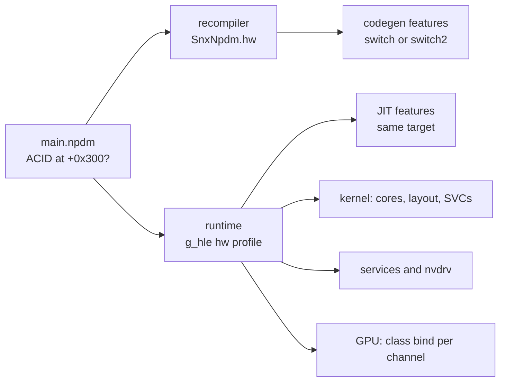

<!-- SPDX-License-Identifier: GPL-3.0-or-later -->
<!-- Copyright 2026 the ScarletNX contributors -->
# Switch 2 titles

ScarletNX recompiles and runs Switch 2 programs next to Switch 1 ones. The NPDM selects the hardware profile, and a
Switch 1 game gets the same recompiler output and runtime behaviour as before. This file gives the state of the work,
the design of each layer, and what the SDK expects at each step, with the evidence for it. The commits keep the test
counts and the run results of each step.

The four dumps that the work was checked with are called A to D. Their names stay off the repository.

## Index

* [Status](#status)
  * [Known open problems](#known-open-problems)
  * [Verification](#verification)
* [What differs from a Switch 1 title](#what-differs-from-a-switch-1-title)
* [The hardware profile](#the-hardware-profile)
* [CPU and the module ABI](#cpu-and-the-module-abi)
* [Kernel and memory](#kernel-and-memory)
* [The graphics supervisor (GSV)](#the-graphics-supervisor-gsv)
* [nvdrv](#nvdrv)
* [Display](#display)
* [GPU engines](#gpu-engines)
* [Shaders](#shaders)
* [Rendering](#rendering)
* [Video](#video)
* [The GPU thread](#the-gpu-thread)
* [Sources and licenses](#sources-and-licenses)
* [Open questions](#open-questions)

## Status

Measured on Linux with an AMD Ryzen 5 9600X, an AMD Radeon RX 9070 and RADV 26.2.5.

| Dump | State |
| --- | --- |
| A | Boots through its menus, intro, story text and early gameplay at up to 60 FPS. Its tutorial movies play (native VP9). The destructible terrain draws black, see below. |
| B | Boots through difficulty selection and the intro dialogue, mostly at 59 FPS. |
| C | Boots to its title, plays its opening movie, and renders a race with textured roads, vehicles and scenery at about 25 FPS. |
| D | Shows its animated loading screen. Progress past loading is not verified. |

A dump is extracted with a Switch 2 dump tool into a folder with `exefs/` and `romfs/`, and recompiled from that folder
(`scarletnx -r FOLDER`, or `scarletnx FOLDER` to make and play it). The launcher lists such a folder in `dumps/` and
its libraries, and F on the Switch screen picks one. A game without a `control.nacp` is shown by its title ID.

A refused native compute dispatch stops the game with a fatal error, and its QMD releases do not run, so the guest
never sees work completed that did not run. A refused graphics program skips its draw, with a log line.

### Known open problems

- **The destructible terrain of A draws black.** Before the passthrough geometry change it was invisible. Its culling
  counters are never reset, see [Passthrough geometry culling](#passthrough-geometry-culling).
- **A loading frame can lose the device.** Twice, a loading frame of C uploaded about 1.2 GB of textures, RADV refused
  the submission and the device was lost. This happened before the texture changes too. A run can also end with "Not
  enough memory for command submission".
- **The CPU limits the frame rate.** C's race runs at about 25 FPS, where other emulators reach 60. The runtime's GPU
  thread, a CPU thread, is saturated while the GPU idles, see [The GPU thread](#the-gpu-thread).
- In A's shader containers, 49 programs are still refused: TXD (`b6c`, 44), `b07` (3) and two paired vertex programs
  with no `EXIT`. Each count is of the first refusal in a program, so one form can hide others. Partial `WARPSYNC`
  masks are refused too.
- The translator's F32 to F16 conversion uses `packHalf2x16`, whose rounding Vulkan leaves to the device. The
  console rounds to nearest even, lavapipe truncates. This also applies to Switch 1.
- A save state is refused while a native codec or image pool is active, and the changed HLE layout refuses the save
  states of earlier builds, also for Switch 1 games.
- Native video decodes VP9 to NV12 only. AV1, H.264, RGBA output and the encoder are not implemented.
- GameShare streaming is not implemented. `stpl:u` reports no connected guest.

### Verification

- `ctest --test-dir build`. `vulkan_ampere` (with `SNX_TEST_VULKAN=ON`) runs the native GPU checks: each lowered form
  against expected values or pixels, QMD releases, 32 storage bindings, root tables, mesh and task programs, sparse
  arrays. `ampere_shader` checks the lowering on the CPU, `mme_tu104` the macro interpreter, `llvm_pauth` pointer
  authentication. Each new GPU check was also run with a deliberately wrong expectation, and failed.
- QEMU's user mode enables the address keys, so LDRA is listed in `tests/llvm_qemu_expected.txt`.
- `build/snx-shaderc --ampere` lowers and translates the programs in a dump's shader containers and the runtime's
  captures, and lists the refusals ([DEVELOPMENT.md](DEVELOPMENT.md#shaders)). `--validate` runs `spirv-val`.
- Switch 1 stays the same: `tools/switch1_check.py SCENE --run`
  ([DEVELOPMENT.md](DEVELOPMENT.md#checking-a-change-against-switch-1-games)) compares the SPIR-V of a Switch 1
  game's shader corpus with a base build and plays a scene against a reference run. A Switch 1 game recompiled before
  and after a CPU change gives the same module, with every code unit from the unit cache.

## What differs from a Switch 1 title

| Layer | Switch 1 | Switch 2 |
| --- | --- | --- |
| CPU | Cortex-A57, Armv8.0 with CRC32 and crypto (`a64.profile` target `switch`) | Cortex-A78C class. The main module of A has 111,506 `RETAA`/`RETAB`, 23,134 LSE `LD<op>` and 7,976 `CAS`. Every function signs its return address with the B key. |
| NPDM | ACID magic at ACID offset + 0x200 | ACID magic at ACID offset + 0x300 |
| Cores | 4 | 6 application cores |
| Counter | 19.2 MHz | 31.25 MHz. The SDK builds that constant with `MOVZ`/`MOVK` in 4 places, reads `CNTPCT_EL0` in 44, and never reads `CNTFRQ_EL0`. |
| SVCs | `hos.svc` | 0x80 `SetGpuMemoryAttribute` and `GetInfo` 29 to 33 |
| Memory | 8 GiB heap region | A larger heap region, and an application pool of about 9.6 GiB |
| GPU memory and sessions | nvdrv: `nvhost-as-gpu`, `nvhost-gpu`, `nvmap` | `ISelfController` 2000 opens `IGraphicsSupervisor`. It gives `IGpuSession`, `IGpuWorker`, the syncpoint and event supervisors, `IVi2Session`, and video contexts. nvdrv adds `/dev/nvhost-tsg-gpu`. |
| GPU classes | `MAXWELL_B` 0xB197, `KEPLER_COMPUTE_B` 0xB1C0, `MAXWELL_DMA_COPY_A` 0xB0B5 | `AMPERE_B` 0xC797, `AMPERE_COMPUTE_B` 0xC7C0, `AMPERE_DMA_COPY_B` 0xC7B5 |
| Macros | Maxwell MME | TU104 MME: 96-bit instructions with two ALUs |
| Compute | Kepler QMD | QMD 3.0 with dependency scheduling |
| Shaders | Maxwell SASS, 64-bit instructions with control words | Ampere SASS (SM 8.x), 128-bit instructions, uniform registers, `BSSY`/`BSYNC` reconvergence, mesh and task stages |
| Video | NVDEC through host1x | a native decoder service through GSV |

## The hardware profile

The NPDM decides the profile on both sides of the module boundary: in the recompiler (`snx_parse_npdm` sets
`SnxNpdm.hw`) and in the runtime (`main.c`'s `npdm_layout` sets `g_hle.kernel.hw` before `mem_init` and `jit_init`).
Both call `snx_npdm_hw` (`nx/loader/hw.h`): an NPDM whose ACID magic is at +0x300 is a Switch 2 program, as
Switchbrew's ACID layout for the larger signature and key gives. The platform byte of the program ID (`04` for Switch 2
titles) is a second signal, and the runtime logs when the two disagree.

Two reads at different times can still disagree: a replaced NPDM would give the runtime JIT another target than the
AOT module. So the recompiler ends the made line of the `<exename>.abi` stamp with ` switch2` (`SnxGameMade.switch2`,
`mods.c`), and the runtime stops with a message when the made line and its own profile disagree. The comparisons of
the stamp do not read the made line, and the module descriptor (`module_abi.h`) stays as it is.

The rule for each change:

- **An addition** (an SVC, a service, an IPC command, a device, a class) is not gated. A Switch 1 game never calls it.
  Where Switch 1 firmware answers such a call with an error, the handler checks the profile and gives that error.
- **A change** of something that exists (core count, memory layout, counter rate, GPU characteristics, method
  handling, GOB order) is gated on the profile. The Switch 1 branch keeps its code.

## CPU and the module ABI

- `a64.profile` has a target `switch2`, from the Cortex-A78C TRM (B2.79 and B2.80): v8.0 with `FEAT_CRC32 FEAT_AES
  FEAT_PMULL FEAT_SHA1 FEAT_SHA256`, and `FEAT_LSE FEAT_RDM FEAT_LOR FEAT_PAN FEAT_UAO FEAT_RAS FEAT_FP16 FEAT_DotProd
  FEAT_LRCPC FEAT_LRCPC2 FEAT_FlagM FEAT_SSBS FEAT_PAuth`. The target lists what the hardware has, not what the
  emitters do: an extra feature would let more decoder rows match and hide an UNDEF that the console raises.
- `ir_codegen.c`'s `decode` takes the features that `ir_int.c` implements (`IR_INT_FEATURES`): the Switch's and
  `FEAT_PAuth`. For the `switch` target the decoder never makes a PAuth op, so its code does not change.
- Pointer authentication runs as with the address keys off (`SCTLR_EL1.EnIA/EnIB/EnDA/EnDB` clear), as eden-ns2 runs
  these programs:
  - `PAC*` and `AUT*` do nothing. `XPAC*` and `XPACLRI` strip, with bit 55 extended over the bits from 48 up.
  - `RETAA`/`RETAB`, `BRA*` and `BLRA*` are `RET`, `BR` and `BLR`. `LDRAA`/`LDRAB` (`ir_ldst.c`) load at Xn plus the
    signed, scaled offset, with the pre-index form.
  - `PACGA` has no enable bit. The SDK uses it only to sign a saved context (x19 to x28 against x17) and check it in
    the same run. EL0 cannot read the key, so a keyed function that stays the same in a run is enough: two rounds of
    MurmurHash3's `fmix64` under a fixed key, inline in the IR. eden-ns2 computes QARMA. The inline form leaves
    `rtlib.c`, and every Switch 1 module, as it was.
- `codegen_view.c` passes `snx_hw_a64(npdm.hw)` as the features, `jit_init(hw)` gives the JIT the same target, and
  `module_llvm.c` keys a `--jit-cache` import the same way. `SNX_IR_EMIT_VERSION` names what the emitters make of a
  word, in the JIT cache key and the recompiler library's module cache key: a cache that an older build wrote kept the
  undefined instruction where PAuth now runs.
- `CNTFRQ_EL0` is an inline constant (`read_sysreg` in `ir_int.c`): 31.25 MHz for `switch2`. `CNTPCT_EL0`,
  `CNTVCT_EL0` and `svcGetSystemTick` come from `rt->ticks()` at 31.25 MHz for the profile (`clock.c`).

## Kernel and memory

- `NCORES` is the size of the arrays (6). `kernel_cores()` (`hle.h`) is the count of cores in use (4 or 6). Every loop
  and check in `thread.c`, `svc.c`, `svc_mem.c` and `main.c` uses it. A loop over `NCORES` that a merge brings in does
  not show as a conflict, so read each one.
- `GetInfo` 29 to 33 answer for the Switch 2 profile only. The SDK reads 29 and 30 as the remote region
  (`nnosInitialize` makes an allocator of 64 KiB granules over it), 31 and 32 as the remote memory used and its total
  (`nn::os::GetRemoteMemoryUsage`), and 33 as the mapping alignment, a mask in `nn::ro::ProtectRelro` and the address
  space manager. As in eden-ns2, there is no remote region, and the alignment is the 4 KiB page.
- `SetGpuMemoryAttribute` (0x80) changes the `GpuAccessible` bit (0x20) of mapped pages, and memory queries report
  it. The SDK changes the CPU cache attributes of such memory, so the memory validator keeps the bit while it changes
  CPU attributes. `SetMemoryAttribute` cannot change it. SVC 0x80 uses the common attribute setter, with its recovery
  of a lock with no owner.
- The SDK's startup heap is `align_down(GetInfo(21) - GetInfo(22), 2 MiB) - 0x195000000`, so 6480 MiB stay outside
  the heap and the Switch 1 pool cannot hold it. `mem_layout_switch2` grows the 39-bit heap region to 12 GiB, with the
  stack and kernel pages after it, and the alias region as it was. Smaller host reservations cap the heap so that all
  regions fit. `svc_mem.c`'s `pool()` gives 9809 MiB for the Switch 2 profile, the application pool of Eden's 12 GB
  memory arrangement, and `memory_fit` still limits it. This is an emulator policy, not a console value.
  [MEMORY_ACCOUNTING.md](MEMORY_ACCOUNTING.md) has the checks.
- A heap request must be 2 MiB aligned and below the fixed 12 GiB maximum. Region exhaustion answers OutOfMemory,
  not InvalidSize, and `heap_max_mb` is converted before the NPDM selects the layout.
- `state.c`'s `state_schema` hashes the layouts of `Hle`, `GpuChannel`, `MemBlock` and more, so the larger arrays and
  the new state refuse the save states of earlier builds, also of Switch 1 games.

## The graphics supervisor (GSV)

`IApplicationProxyService` 10 (`OpenApplicationProxyWithFlags`) takes a u32 of flags before the pid and process
handle, and gives the proxy that 0 gives (the SDK sends 0). `IApplicationProxy` 40 and 60 give the performance and
graphics-scaling objects: `IGraphicsScalingParametersFunctions` 10 answers eden-ns2's fixed `{10, 1, 1}`, of which
the ratio's meaning is inferred. `IApplicationFunctions` 320 and 321 report capture and sharing off, and
`ISelfController` 2400 takes the RTC audio flag.

`ISelfController` 2000 returns a copy handle to one GSV session for the application, which every `SelfController`
shares. Its dispatcher takes TIPC only. Several commands write a move handle that the SDK reads before the result, so
their failed replies keep a null handle slot (`c->tipc_error_moves`, [IPC.md](IPC.md)).

| Commands | What they do |
| --- | --- |
| 4, 11, 101 | Initialize, bind the application process, complete the bootstrap, in this order. Modes 1 and 5 to 7 with bit 63 set. |
| 1402, 201, 202 | Open the NVDRV service, initialize and open a syncpoint session |
| 204 | `BindSyncpointMemory`: 4 KiB read-write and 8 KiB read-only transfer memories, the version-1 cache header for 192 counters, and a request and a completion event |
| 115 | `ConfigureNativeMemory`: local modes 0 and 2, no optional modes |
| 1101, 1102, 401, 402 | Initialize and activate the frame and GPU contexts. Repeated initialization keeps the activation. |
| 497 | `OpenGpuSession`: modes 3 (older SDK) and 4 |
| 301, 303, 305 | The display context, and the VI2 display session ([Display](#display)) |
| 435, 1510 | The size of a native image (`CalculateNativeImageSize`, `CalculateRequirements`) |
| 111, 112, 423, 114 | Native memory: make, destroy, back with an offset in registered GPU memory (423) or with CPU memory (114) |
| 429, 430, 315, 314 | Native images, and the alias image pools of the vi2 window |
| 434 | Register a GPU address space before its worker maps into it |
| 901, 902, 911 to 991 | Video contexts and pools ([Video](#video)) |

The syncpoint session answers the challenge (0), event capacity and count (1, 21), events (22), counter queries (103),
waits (201) and cancellation (202). Counters are NVDRV's 32-bit ones, and waits compare across wraparound. Counter
replies are a u64 value and a one-byte value mode, and the three bytes after the mode in a wait are padding. For 204,
the SDK toggles group and slot bits and signals the request event. The runtime refreshes the toggled counters in
`svcSignalEvent`, publishes the slot acknowledgements before the group's, and signals completion, also when no bit
differs (eden-ns2 polls every 1 ms and returns early there). Unallocated counters read as all ones.

The GPU session (`nvdrv.c`) answers the notification range 0 to 63 (11) and an event for a slot (12).
`RequestWorker` (21) needs that event, makes one worker session that the control session keeps, and signals the
event. `AcquireWorker` (22) gives another handle to it. The control session and the worker share their state through
a counted pool entry, so a worker can outlive its control session without a reference cycle. Then the session gives
graphics-device ids (41, 42), an address-space id (33), and the user and supervisor partitions (201 to 203). The user
range is `[0x8000000, 0xC000000000)` with an inclusive last address, as Eglantine answers. The runtime has one GPU
page table, so it holds one GSV address space at a time.

The worker registers GPU-accessible memory (101), maps it at a GPU address with its uncompressed kind (211 to 213),
reserves and remaps sparse regions, and releases a registration (102). 102 signals its event only on success, and is
refused while a mapping uses the registration. The SDK sends an explicit identity map after 101, so registration maps
nothing. Closing the last worker removes its mappings and registrations.

Native memory is an nvmap handle, because the SDK reads its NvRm memory id. An image holds a reference on its memory,
so 112 answers Busy while one lives, and an image answers Busy while it is a window's pool. Image handles are never
reused: an array takes count consecutive handles. The size of a native image follows the SDK's 64-byte preference:
the extent word is `(width - 1) | (height - 1) << 16`, word 4 is log2 of the block height, word 5 the row pitch in
64-byte GOBs. The size is the pitch times the height padded to whole blocks, times the count.

## nvdrv

- **Characteristics.** The Switch 2 driver asks `GET_CHARACTERISTICS` for 0xd0 bytes and reads the bytes from 0x70 as
  signed 16-bit interface levels, one for each nvhost device. Its device setup fails when the address space level, at
  0x78, is below 6, where the GM20B layout has `max_ltc_per_fbp` (2). The answer has the Ampere chip 0x17E, 4 KiB pages
  beside 64 KiB, the capability flags, the levels and 64 subcontexts, from eden-ns2. The SM version is 8.8: one
  driver has its built-in GPU programs for no other version, and a retail console runs it.
- **SM mapping.** `VSMS_MAPPING` (0xC0084713) fills the buffer with 0xC0 and fails when the last `{gpc, tpc}` pair
  stays so. The answer has a pair for each of four SMs.
- **TSG.** `/dev/nvhost-tsg-gpu` binds and unbinds channels (0xC0045401, 0xC018540B, 0xC0045402), selects one of 64
  subcontexts, and takes a timeslice. A channel belongs to one group at most, and closing either end removes the
  membership. GPU channels report interface level 0x1F and answer `SetPreemptionModes` (0xC008481F): at 0x1D one SDK
  gave up its first queue, and a later queue read that queue's null TSG.
- **Address-space views.** The driver opens `nvhost-as-gpu` and sends `ALLOC_AS_EX` with flags 5, the GSV address
  space id as `as_fd`, and 4 KiB pages. The view keeps the id. Ids are never reused, so a view whose address space has
  gone answers InvalidState. Legacy allocations start past the GSV user partition, and a native view refuses legacy
  allocation and mapping ioctls.
- **Syncpoint page.** Ioctl 0x0b reports a read-only page with stride 4 and 192 counters, at the end of the 40-bit GPU
  address space. Reads give the live counters. The place is a choice of the runtime.

## Display

GSV 301 and 303 start and end the display context. nn::vi2's user library then sends 305 with one u64: `0x3'0001'0000`
in one title, `0x3'0002'0000` in two others. The runtime accepts the high word 3 with `0x1'0000` to `0x4'0000`.

`IVi2Session` (`vi.c`) answers what the library sends at startup: 3, 1, 11, 101, 201, 212, 251, 111, 5, 51, 31, 261
and 32. A trace of the library (the three SDKs have the same code) shows what the answers to 1, 3 and 5 do:

- 1 is the last notification index. The library caps it at 0x3FF, keeps `(last + 32) / 32` words of notification
  bits, and gives out every bit in them. `vi.h` derives the session's words, the client bits that 201 accepts and the
  bit that 101 accepts from `VI2_LAST_NOTIFICATION`.
- 3 is stored as `min(3, 7) + 1`, and only the setup and teardown of the library's context write that field. The
  request groups come from the library's own bitmap of 8.
- 5 is capped at 7 and goes back to 51 unchanged.

So eden-ns2's answers (0, 0, 7) and Eglantine's (1, 1, 7) give the guest the same state. A client (201) names two
bits, for its retirement and for a free buffer. The display's own bit is set when its last reference closes.
`player1` to `player3` open, bind and close as the default display does, because the stream-play SDK makes their
resources at startup. Commands 261 to 272 register a group's event for six kinds of display change: `vi_vsync_tick`
signals kind 0 at 60 Hz, and the other kinds signal once.

The window presents its native images (429, 315) through the present path that `vi.c` and `present.c` use, and a
slot comes free after its fence. `vi2_state_valid` checks a save state's bits, clients, endpoint, monitors and vsync
membership.

## GPU engines

The Ampere classes are front ends of the Maxwell engines. The renderer reads only the neutral draw and dispatch state
(`gpu/draw_state.h`). The Ampere code writes Maxwell registers, Kepler QMD words, or QMD 3.0 words that the readers of
`kepler_compute_regs.h` understand. What has no Maxwell register goes into the native fields of the neutral state.
These rules keep the Switch 1 path apart:

- The Ampere code writes a register through the engine's method path, as a pushbuffer's write does, never into `r3d`
  directly. A method that only the native class has needs a dirty group (`g_m3d_group` in `maxwell/engines.c`):
  `R3D_NATIVE` for the pixel rate registers and the root tables, `R3D_SHADER` for `MESH_CONTROL` and the program slots.
  `SNX_DIRTY_CHECK=1` finds a register that a group misses.
- `vk/` reads native state only from `DsState` and `DispatchState`, never from a `GpuChannel`:
  - `DsPrograms` has `native`, `mesh` and `mesh_shader[2]`. For a native class, `mx_draw_programs` reads each slot's
    40-bit address from its words 5 and 6.
  - `DsNative` has the pixel rate selection and tables, and the root tables.
  - `DispatchState.native` marks a QMD 3.0 launch. `renderer.h`'s `dispatch` returns 0 when it refuses one, and
    `release_reduce` does QMD release reductions in stream order.
- `gpu.c`'s `engine_of` picks the engine by the low byte of the class, so 0xC797, 0xC7C0 and 0xC7B5 land on the 3D,
  compute and DMA engines. The class bind keeps the full class, and the decoders check it where the meaning differs.
- `gpu/nvn/nvn_loader.c` leaves a Switch 2 program's own NVN driver alone, so its command streams reach the front end.
  Nobody has measured the NVN2 layouts.

### TU104 macros

`maxwell/mme_tu104.c` interprets TU104's 96-bit instructions for 0xC797 and 0xC7C0, with Mesa's encoding: two ALUs and
two outputs, predicates, loops and branches with a delayed exit, data RAM, MME DMA reads and writes through
`gmem_read` and `gmem_write`, the `READ_FIFOED` parameter FIFO and DMA sync at 0x15C. A wait can stop between the
outputs and resume without a second ALU step or parameter read. Upload pointers and macro starts count instructions,
not words: each instruction takes three upload words. The upload decodes an instruction when one of its words arrives
(`MmeTu104Ins`): one game calls about 55,000 macros a frame. MME DMA reductions and system memory barriers stop with a
diagnostic.

Channels in one TSG share their programs and start addresses. Compute uses the graphics program until a compute 0x45
or 0x47 gives it its own, and graphics and compute share the channel's data RAM, as in Eglantine. An open TSG keeps
its programs with no channel. A submission carries a TSG lifetime id, not the fd, so a reused fd cannot change a
queued job's programs. Save states carry the program groups and the channels' native state (`GPU_STATE_VERSION` 4).

### Compute and QMD 3.0

The QMD 3.0 decode writes the Kepler QMD words that `vk/compute.c` reads. Dependency scheduling, inline descriptor
uploads, semaphore releases and their reductions stay in the processing of the commands. A field that the Kepler QMD
cannot hold stops the launch with a log line. The driver owns a native submission's fence increments.

### 3D methods

- **Vertex streams.** C797 gives each stream's 40-bit size at byte offsets 0x600/0x604 (methods 0x180/0x181), two
  words per stream ([`clc797.h`](https://github.com/NVIDIA/open-gpu-doc/blob/master/classes/3d/clc797.h)).
  `maxwell/ampere.c` writes `start + size - 1` to the Maxwell limit at 0x7C0 after the size or the start changes.
- **Root tables.** `SET_ROOT_TABLE_SELECTOR` (0x504) and `LOAD_ROOT_TABLE` (0x508) fill eight 256-byte tables, which
  native programs read as banks 24 to 31. One game uploads `1/2880`, `1/1620`, `2880` and `1620` to table 0 before its
  vertex programs read `c[24][0]`. The channel keeps the bytes and the cursor, and the renderer binds the tables in
  one uniform buffer of their own. The 18 ordinary graphics banks stay as they are. Banks 18 to 23, indexed root
  loads and root texture descriptors are refused.
- **Pixel rate.** Vertex programs write `VPRS_TABLE_INDEX` (attribute 0x5c, Mesa's NAK map). The selector is at
  0x2cc and the 16 tables at 0x2a00. The policy is full pixel rate: before each draw the renderer checks the selected
  tables. Rate 0 (cull), supersampling, reserved rates, and coarse rates with fragment memory effects are refused.
- **Mesh and task stages.** A draw with `MESH_CONTROL` (0x453 bit 0) binds a mesh program in the vertex slot, or a
  task program there and its mesh in the tessellation slot when that slot's enable is on. The geometry slot then holds
  only the header that names the per-primitive attributes. `MESH_SHADER_A` and `_B` give the counts.

## Shaders

Ampere SASS has nothing in common with the Maxwell encoding of `shader/decode.c`. `shader/ampere.c` lowers each native
instruction into Maxwell instructions and control words, and the existing translator runs on the result. The encodings
are checked against Mesa NAK's `sm70_encode.rs` and NVIDIA's `nvdisasm`, and the reference lowerings are cross-checks.
Each form accepts only the encoding that a game uses and refuses the others. Unsupported instructions, modifiers and
register ranges refuse the whole program.

### Containers and headers

The shader containers (`Shader/*.bfsha.zs`) are zstd streams of a BFSHA with an embedded BNSH. A native program is a
128-byte header at a 256-byte boundary, then 16-byte instructions to an `EXIT`, with no `0x12345678` wrapper. The first
header word is an SPH with version 4 instead of 3 (`shipped_native_programs` in `shipped.c`). The runtime gives the
first 80 bytes to the translator as a Maxwell header. Graphics programs come from the C797 stage addresses at
stage-base methods +5 and +6. A game whose engine packs its files in archives of its own (D) has no containers to read,
only captures.

### Lowering

- **Registers.** Native programs use R0 to R175. R176 to R191 are the tensor-core scratch registers, and the uniform
  registers go in R192 to R247. A program that the first layout cannot hold tries a second: R0 to R239, with UR0 to UR7
  in R240 to R247 and no scratch. R248 to R254 are the lowering's. The uniform predicates are a packed bank of their
  own, swapped in for each uniform predicate operation.
- **Branches.** A branch displacement starts at bit 34: bit 32 is `.U`, which NVIDIA's compiler sets. `BRA` can carry
  a condition predicate besides its guard. `BSSY` targets stay jump-table metadata, and `BSYNC` is not turned into a
  Maxwell stack-pop jump: a branch out of an inner scope left a token behind, and a later `BSYNC` returned into skipped
  lighting code.
- **Indirect branches.** `BRX` after an indexed load names an absolute native PC, which expanded code cannot use. The
  lowering compares the register with each instruction start and branches to its relocated start.
  `shader_native_brx_prune` reads the jump table through the constant buffer reader (recorded in the pipeline's key)
  and cuts the comparisons to the cases inside the switch's scope: 1,444 comparisons became three in one program.
- **Calls.** The translator keeps return addresses on a stack apart from the reconvergence tokens, so a leaf call is
  safe inside a `BSSY` scope. The lowering verifies the return-PC setup. `shader_leaf_end` recognizes a leaf callee,
  and the translator writes it in place of each call, so the program stays structured.
- **Tensor cores.** `HMMA.16816.F16` is a subroutine at the program's start, behind a `BRA`: lanes exchange fragments
  with `SHFL`, products accumulate in F32 from C, and the sums round to F16 after the eighth product and at the end,
  as eden-ns2 models it. `MOVM` and `LDSM` lower in place. One upscaler took 90.6 ms of a 100.3 ms frame as an
  unstructured loop, and the leaf call change made it a structured program.
- **Warp operations.** `WARPSYNC` is a subgroup execution and memory barrier, which needs 32-lane subgroups: native
  compute pipelines require them through subgroup-size control, and a host without them refuses the program. Partial
  masks are refused.
- **Passthrough geometry.** A passthrough geometry program installs an exit hook (`LEPC`, the 64-bit add, `BMOV.64
  ATEXIT_PC`) whose body is `OUT.FINAL` and `EXIT`. The lowering verifies the hook and drops it, because the
  translator emits the primitive at exit. The translator keeps `ViewportMask` (`a[0x3a0]`): zero culls the primitive,
  another mask emits it at the viewport of its lowest bit.
- **Extents.** Native compute and graphics reads start at 64 KiB and 128 KiB and grow to the extent that the branch
  and leaf scans need, up to 512 KiB of instructions. The lowered output can hold 65,536 Maxwell words, the most that
  `shader_resolve_crs` walks.

A refused native compute dispatch saves its QMD and program under `captures/` with the `diag` setting, also past the
capture budget. `snx-shaderc --ampere --diagnose` lists the refusals behind the first one of each program.

### Native direction

The lowering keeps the Maxwell translator as the only SPIR-V path. A native Ampere decoder would remove the synthetic
Maxwell encoding and the register-layout limits, and give `BSSY`/`BSYNC` and the warp operations their native
semantics. It would reuse `common/utilities/spirv_emit.c` and the structuring algorithm, and replace the lowering once
it covers the programs that the games run. The Switch 1 Maxwell path stays.

## Rendering

- **GOB order.** Switch 2 GOBs exchange byte-address bits 5 and 6. A garbled BC4 icon of A matched the Switch 1 order
  within BC4 rounding. `vk/blocklinear.c` selects the order with specialization constant 0 of the one move pipeline,
  and the inline writes and `bl_land` follow it ([BLOCKLINEAR.md](BLOCKLINEAR.md)).
- **Storage bindings.** Both profiles allow 32 global memory bindings, in the device's limits. Bindings 16 to 31
  follow the texture bindings, so the old binding numbers stay.
- **Storage descriptor sizes.** A native compute program reads `{address, size, 0}` from cbuf 0 at 0x20 to 0x100.
  The renderer bound each address to the end of its mapping (16 MiB), and one transition landed about 41 GB in 50
  presents of which 8 MB changed. A descriptor now takes its size when the word after it is zero and the size is a
  nonzero multiple of 16 that the mapping holds. `global_dynamic` uses the same size (`ShaderInfo.gbuf_native`).
- **Null images.** A descriptor with image address zero binds a Vulkan null image (`nullDescriptor` of
  `VK_EXT_robustness2`), as the references treat it as unbound.
- **Sparse arrays.** TIC word 3 bit 12 aligns each array layer to 64 KiB. Large virtual arrays (`8192x8192x68`) get
  Vulkan sparse residency for their mapped levels, and hashes and write checks visit only mapped ranges. A sparse-bind
  timeline orders both queues.
- **Mesh and task.** The translator emits `SPV_EXT_mesh_shader` modules, and the renderer records
  `vkCmdDrawMeshTasksEXT`. The mesh in the tessellation slot gets descriptor set 3. A device without `taskShader` or
  `meshShader` refuses the draw.
- **Pre-rasterization stores.** A tessellation or geometry program's global memory goes to the slot that a mesh
  program uses, and needs `vertexPipelineStoresAndAtomics`.

### Passthrough geometry culling

A's destructible terrain draws through a passthrough geometry program that culls triangles by their facing and the
pixel centres that their bounds cover. It appends each kept triangle's indices to a list through an atomic counter
(`c[0][0x410]`, list at `c[0][0x420]`). Its depth pre-pass and shadow draws now run, but no main-pass draw shades the
terrain, so it shows black. The counters are never reset: a trace over 50 frames found 27, 54, 81, and so on, and no
CPU or engine write touches them. The list of 2,500 triangles fills after 7 to 280 frames. On the console something
resets the counters and reads the list. A GDB watch on the counter's guest memory is the next step.

## Video

GSV 901 opens the video context, 902 a decoder context, and the SDK opens the encoder context too at library startup.
The codec session initializes transfer memory (200) and selects VP9 by its MIME string (101). `native_video.c` decodes
with FFmpeg, keeps a bounded input queue, registered output images and the submission event. Video pools share the
native image handles: 991 sizes them, 911 makes them, 961 describes their CPU planes, and 426 to 428 map and describe
the GPU image.

The output is pitch-linear NV12, with the pitch rounded up to 256 bytes and the heights to four rows. The renderer
interleaves the chroma on the GPU and publishes the image over guest memory. Acquisition fences use syncpoints and
the renderer's completion queue. Details that the SDK expects:

- `SubmitVp9DecoderInputBuffer` writes the EOS flag with `STRB` at TLS offset 0x1c, and the other three bytes keep
  old reply data: command 109 declares a u8.
- EOS comes with timestamp -1, and the SDK then loops the decoder with Flush and Start. EOS drains and resets FFmpeg,
  and a pause Flush keeps the VP9 reference pictures.
- A 2560x1440 movie initializes with input format 3, where a 640x360 one sends 1. Both are 8-bit 4:2:0 VP9.
- After Stop, the SDK destroys the pool (912) and then its native memory (112) at once, with the images still mapped.
  912 drops the native image and its reference on the memory, and each mapping pins the backing until it goes.

## The GPU thread

In C's race the frame rate is limited by the CPU, not by the GPU. A Switch 1 game gives the runtime NVN
calls. A Switch 2 game gives it command streams, so one thread decodes every method, runs every macro, and finds every
draw's and dispatch's resources. In C's race on the Ryzen 5 9600X, that thread ran at 83 to 94% of a core, and no game
thread above 15%. `vk_gpu_profile=1` times each graphics-queue dispatch: 4.8 ms a frame. The graphics queue was busy
for 19.6 ms of a 41.5 ms frame, and idle for about 16 ms while the CPU recorded the next submission. With DWARF call
stacks (`perf record -e cycles:u --user-callchains --call-graph=dwarf`), the thread's time was:

| Part | Share | Change |
| --- | --- | --- |
| TU104 macro interpreter | 23% | Instructions decoded at upload: 18% |
| Texture hashes of textures that dispatches sample | 21% | A piece that one GPU owner holds whole hashes as its tag (`piece_owned`), and remapped textures ask the write tracking per GMMU run. Gone from the profile. |
| Storage buffers copied for the compute queue | 6% | None yet |
| Native compute programs lowered again | 6% | `cs_pipe` finds the pipeline by its code first (`CsSrc`). Gone from the profile. |

What remains is spread out: macro calls with what they emit (about 25%), draw setup (`render_draw` 25%, with
`stage_set` 14%) and dispatch setup (18%). Frame times vary between runs by as much as one change gives, so compare
the thread's time in a profile, not the frame rate.

Earlier changes for the same scene: CPU bytes between GPU-owned pages are staged in whole runs, streamed constants
promote once per present, and queued semaphore reductions fold in stream order (about eight graphics round trips per
present became one). Large streamed textures load only the rows of blocks that the front end wrote.

## Sources and licenses

The primary references are the SDK's code (`tools/disasm.py`, GDB on the recompiled game), Switchbrew, NVIDIA's open
class headers, and Mesa (NAK's `sm70_encode.rs` and attribute map, `mme_tu104`, its mesh notes). Atmosphère is read,
never ported (GPL-2.0-only).

Three emulator trees with Switch 2 work were cross-checks. All derive from Eden, so agreement between them is not
independent proof of what the console does, and each is incomplete:

| Reference | Revision | Use |
| --- | --- | --- |
| eden-ns2: the Switch 2 test build of [Eden pull request #4588](https://git.eden-emu.dev/eden-emu/eden/pulls/4588), not merged. Eden itself has no Switch 2 support. | [`9888072d5d`](https://git.eden-emu.dev/eden-emu/eden/commit/9888072d5dc24719a088de729053b4cdad889ea4), with local changes | The source of `shader/ampere.c`'s lowering and of the GSV, nvdrv, vi2, video and font services |
| [Eglantine](https://github.com/Djihads80/Eglantine/tree/bb353609e6) | `bb353609e6`, `adae763570` | Boot and service order (`nx2_gsv.h`), MME and QMD integration |
| [PokeDinner](https://git.eden-emu.dev/Franseven/PokeDinner-a-Eglantine-Fork/src/commit/774cd4f58), a fork of Eglantine | `774cd4f58`, `1dd40d86d` | Native shader forms, storage descriptor sizes, null images |

`shader/ampere.c` is adapted from eden-ns2's `lower_to_maxwell.h` with changes of a local checkout that are not in
the public commit. [CREDITS.md](CREDITS.md) lists each file with its source, revision and license.

Rules for the references:

- A reference names which service, command, class or method a title uses, and in what order. Check each answer
  against the SDK code that reads it, or against console evidence.
- Port verified behaviour, not structure, and keep each file's copyright lines and license.
- Do not port workarounds. A bilinear blit in place of a tensor-core upscaler, a hard-coded indirect-draw reset
  program, and a skipped compute dispatch reported as complete are not the console's semantics.
- Where a reference takes code from another project, use the original: Mesa NAK for shader encodings and Mesa's
  `mme_tu104` for macros.

## Open questions

1. The console's application memory budget and region layout. The 9809 MiB pool is an emulator policy.
2. The syncpoint count of the Switch 2 stream library. Switch 1's is 128, and eden-ns2 uses 192.
3. `svcGetInfo` 34 on a transfer memory handle: `nn::os::detail::TransferMemoryImplByHorizon::MapImpl<true>` masks the
   answer with the mapping's alignment to place the mapping, so it looks like the source address of the transfer
   memory. Nothing answers it yet, and no boot reaches it.
4. Banks 18 to 23, and the exact limit of the ordinary constant banks.
5. Whether the fields of the version 4 program header past the first word mean what Maxwell's do. Only the programs
   that translate and draw check them.
6. What resets the culling counters of A's terrain, and what reads its triangle lists.
